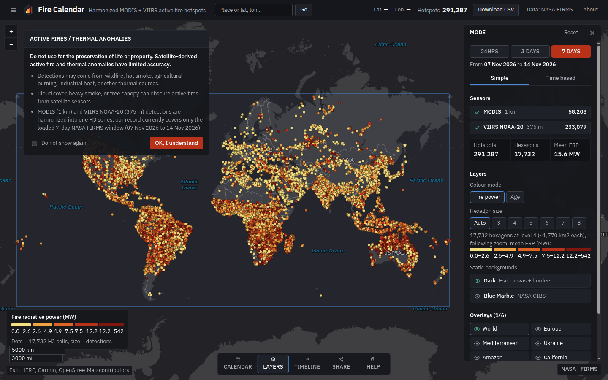

# Fire Calendar

**NASA Space Apps Challenge 2026** — Challenge: *Harmonization of MODIS and VIIRS Hot Spots*
Team "The One" · Dnipro · 14–15 November 2026

## What it is

Two satellites look for fires on Earth: **MODIS** (1 km, since 2001) and **VIIRS** (375 m, since 2012).
They see differently and rate confidence differently, so their numbers cannot be compared directly.
This app converts both into **one format**. The user only sees fires — never "which satellite saw this one".

Pick an area and a period. You get where fires were, when they happened, and whether the month was
normal or not.



## What you can do

- Choose an area: draw a rectangle on the map, type coordinates, or search for a city
- See the hotspots on the map, coloured by fire power (MW)
- Open the burning calendar: year by month, then day by day, with the peak day
- See how the selected month compares with the median of earlier years
- Download what you see as a CSV file

## How two sensors become one series

1. **Clean.** VIIRS "low" confidence is dropped ("nominal" counts as 50, "high" as 90). MODIS below 50 is dropped.
2. **Merge.** Both sensors are now in the same columns, so the app can treat them as one dataset.
3. **Remove doubles.** If both satellites saw a fire in the same small cell on the same day, it counts once —
   and the record remembers whether MODIS, VIIRS or both saw it.

## Why hexagons (H3, made by Uber)

To count fires in an area, you need cells of the same size everywhere. We use **H3** — an open-source
grid of hexagons created by **Uber** and published under the Apache 2.0 licence.

- A hexagon has six neighbours at the same distance. A square grid does not: its corners are farther away,
  so a fire that spreads in one direction looks different from one that spreads diagonally.
- H3 wraps the whole globe, so cells have the same size and shape at every latitude — counts stay comparable
  between Germany and Africa.
- Every detection is put into a cell of about 1 km² (H3 level 8). The map then draws **one shape per cell**
  instead of thousands of single points, which keeps it fast even worldwide.

## Data

Fire data: **NASA FIRMS** — MODIS C6.1 and VIIRS C2 (NOAA-20), <https://firms.modaps.eosdis.nasa.gov>.
The last 7 days are free to download; older years need a free FIRMS API key (`FIRMS_MAP_KEY`).
The database holds **8.7 million detections from 2001 to November 2026**. The historical years cover
Europe, the current window is worldwide. Days without data are shown as such.

## Run it

```bash
python3 -m venv .venv && .venv/bin/pip install pandas duckdb h3 pyarrow requests fastapi uvicorn
.venv/bin/python -m pipeline.build                              # raw CSVs → data/fires.duckdb
.venv/bin/python -m uvicorn api.app:app --port 8100             # API
cd web && npm install && npm run dev                            # http://127.0.0.1:5173
```

The database file is not in this repository (210 MB) — the pipeline rebuilds it.

## Documentation

Developer documentation lives in [`docs/`](docs/README.md): architecture, data model, API, frontend,
development, UI copy rules.

## Credits

Fire data: NASA FIRMS / LANCE. Hexagon grid: [H3](https://h3geo.org) by Uber (Apache 2.0).
Map imagery: Esri, OpenStreetMap contributors. City search: Open-Meteo (GeoNames).
Built with DuckDB, FastAPI, React and Leaflet.
