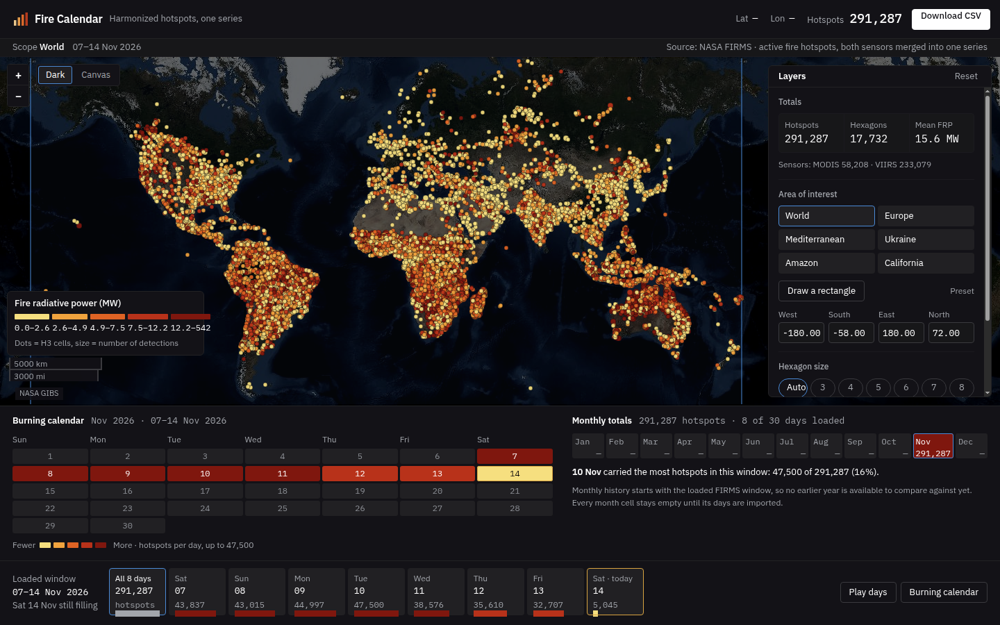
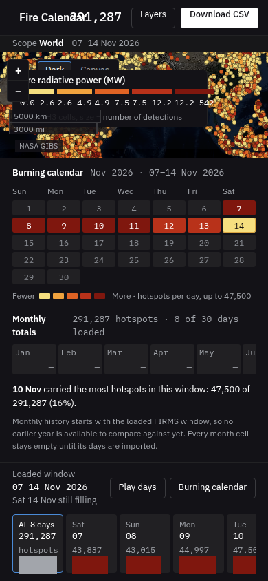

# Fire Calendar

**NASA Space Apps Challenge 2026** — Challenge: *Harmonization of MODIS and VIIRS Hot Spots*
Team "The One" · Dnipro · 14–15 November 2026

## What it is

Two satellites watch fires on Earth: **MODIS** (since 2000) and **VIIRS** (since 2012).
They measure differently, so their data cannot be compared directly. This app turns both into
**one series**, so the user never has to think about which satellite saw a fire.

You pick an area, and the app shows **when fires happen there** — day by day, in a calendar —
together with how strong they were.


## What you can do

- Pick an area: draw a rectangle on the map, type coordinates, or choose a region
- See hotspots on a dark map, coloured by fire strength (MW)
- Read the calendar: which days burned, which day was the peak
- Download exactly what you see as a CSV file

## How two sensors become one series

| Step | Rule |
| --- | --- |
| Confidence | VIIRS "low" is dropped; "nominal" becomes 50, "high" becomes 90. MODIS below 50 is dropped |
| Duplicates | Same 1 km cell on the same day → one record, the stronger detection wins |
| Result | 473,000 raw rows → 291,288 clean records; 11,803 were seen by both satellites |

Each record keeps a note whether MODIS, VIIRS or both saw it.

## How it is built

```
NASA FIRMS data  →  clean + merge  →  database  →  API  →  web app
```

- **Cleaning:** Python (the same rules also written in Rust — 10× faster, 53 MB memory)
- **Database:** DuckDB — a single file, no server, no logins
- **API:** FastAPI with four endpoints (health, cells, calendar, CSV export)
- **Web app:** React + Leaflet, no paid map service, no API keys
- **Map:** dark Esri canvas, switchable to NASA Blue Marble; hotspots coloured by fire strength

## Run it

```bash
python3 -m venv .venv && .venv/bin/pip install pandas duckdb h3 pyarrow requests fastapi uvicorn
.venv/bin/python -m pipeline.build
.venv/bin/python -m uvicorn api.app:app --port 8100
cd web && npm install && npm run dev      # open http://127.0.0.1:5173
```

## Data

Fire data: **NASA FIRMS**. The public download covers the **last 7 days**; older years need a free
FIRMS API key (`FIRMS_MAP_KEY` in `.env`). The app shows exactly what is loaded and never pretends
to know more — days without data are marked as such.

## Screenshots

| Desktop | Phone |
| --- | --- |
|  |  |

## Credits

Fire data: NASA FIRMS / LANCE. Imagery: NASA GIBS, Esri. Design: `design-taste-frontend` + `unslop`.
